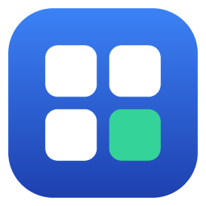
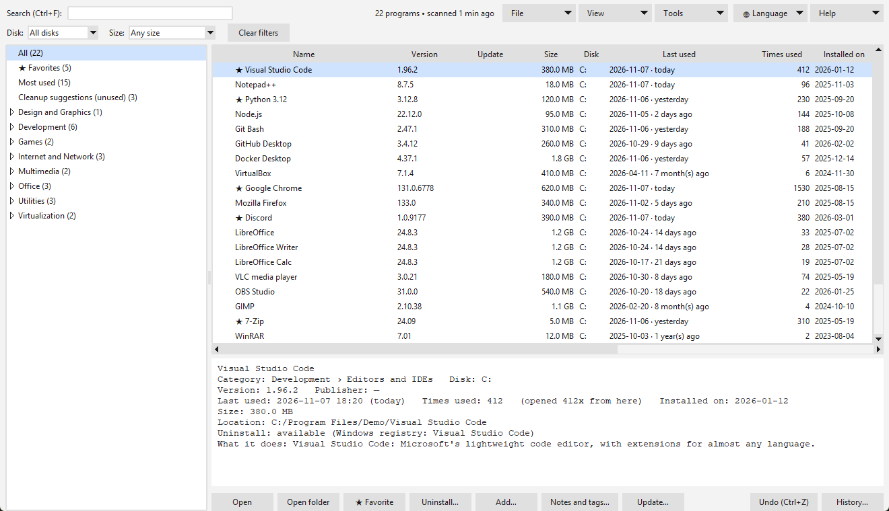
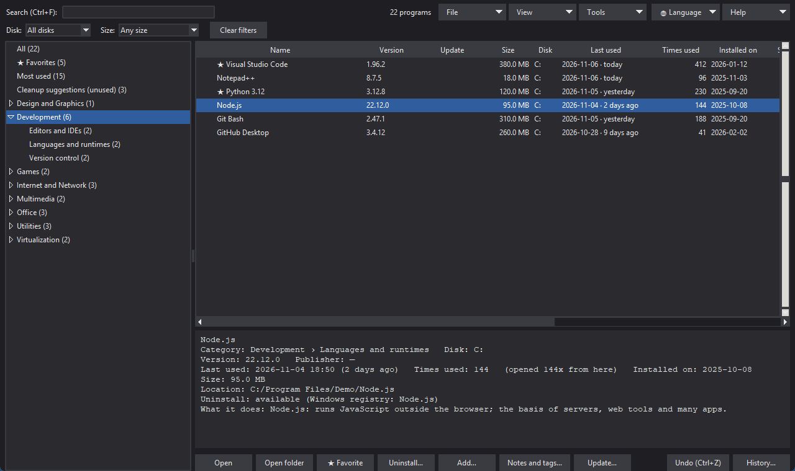
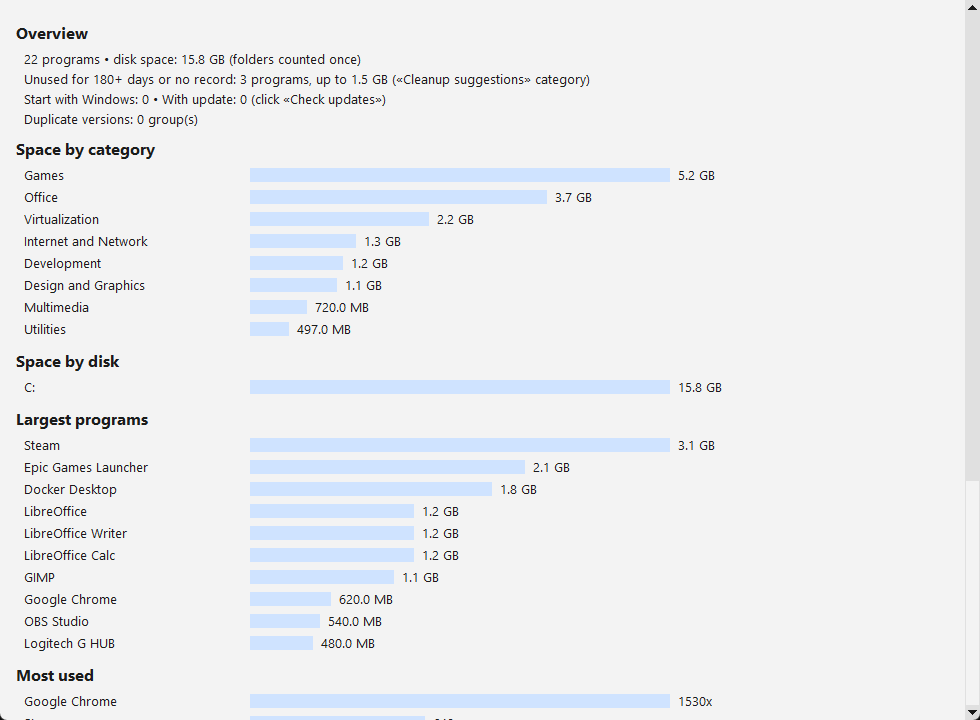

# App-Manager

[English](README.md) · **Português** · [Español](README.es.md)

Catálogo dos programas instalados no **Windows**: o que cada um faz, quando foi usado, quanto ocupa, categorias, e botões para abrir, atualizar ou desinstalar. Python + Tkinter, sem dependências externas, tudo local. A interface vem em **inglês por padrão**, com **Português**, **Español**, **Français** e **Deutsch** a um clique (menu 🌐 *Idioma*).

## Capturas de tela

 

_Dados de exemplo (programas fictícios), temas claro e escuro. A interface das capturas está em inglês, o idioma padrão._

## Requisitos

| | |
|---|---|
| Sistema | **Windows 10 / 11** (usa registro, Menu Iniciar e `winget`; não funciona em Linux/macOS) |
| Versão `.exe` | Nada além do Windows |
| Versão Python | Python 3 com Tkinter e `python`/`pythonw` no PATH (testado no Python 3.15 e Windows 11); só biblioteca padrão |
| Opcional | [`winget`](https://learn.microsoft.com/windows/package-manager/winget/) para a coluna e o menu de atualizações |

## Instalar e usar

**Opção A — `.exe` (sem Python):**
1. Baixe `App-Manager.exe` em [Releases](https://github.com/thomasmeneghelli/App-Manager/releases).
2. Coloque numa pasta onde você possa gravar (ex.: `D:\Apps\App-Manager`) e dê duplo clique. Ele cria seus dados ao lado.
3. Na primeira vez escaneia o PC (1–2 min). O Windows pode alertar (SmartScreen), pois o `.exe` não tem assinatura digital.

**Opção B — Python:**
1. Instale o [Python](https://www.python.org/downloads/) marcando **Add python.exe to PATH**.
2. Baixe este repositório (**Code → Download ZIP**, ou `git clone https://github.com/thomasmeneghelli/App-Manager.git`).
3. Duplo clique em **`App-Manager.bat`**.

Para gerar o `.exe` você mesmo: `build_exe.bat`. **F1** abre a Ajuda dentro do app.

## O que faz

- Lê os atalhos do Menu Iniciar e o registro do Windows; também acha programas que abrem por arquivos `.bat`/`.cmd`.
- Categorias e subcategorias, descrição "para que serve", filtros por disco e tamanho, busca (inclui suas notas e tags).
- Colunas de **último uso**, vezes usado e data de instalação (lidas do UserAssist do Windows).
- Listas prontas: favoritos, mais usados, sugestão de limpeza, iniciam com o Windows, com atualização, versões duplicadas.
- **Atualizar** via winget e **Desinstalar** via desinstalador do Windows (pede senha/UAC).
- **Desfazer**, histórico, backup da configuração, resumo com gráficos e exportação CSV/HTML.
- Menus **Arquivo, Exibir, Ferramentas, Idioma e Ajuda**, tema claro/escuro e atalhos (`F1`, `F5`, `Ctrl+F`, `Ctrl+E`, `Ctrl+Z`).

## Privacidade e segurança

- Tudo roda na sua máquina; nada é enviado para a internet (só o `winget`, se você pedir atualizações).
- O scan e as leituras do registro são **somente leitura**.
- Atualizar e desinstalar **não podem ser desfeitos** pelo app; ele pede confirmação antes. Use por sua conta e risco.
- Seus dados (`user.json`, `index.json`, `updates.json`, `icons/`, `backup/`, `categories.local.json`) são criados localmente e ignorados pelo git. O repositório traz só um catálogo genérico de programas comuns.

## Personalizar

Inclua seus programas e descrições em `categories.local.json` (opcional, mesmo formato do `categories.json`; as suas entradas vencem) e reescaneie. Traduções em `lang/`. Ajuda completa: [English](help/en.md), [Português](help/pt.md), [Español](help/es.md), [Français](help/fr.md), [Deutsch](help/de.md).

## Contribuir

Este é um projeto de hobby, feito no meu tempo livre com o [Claude Code](https://claude.com/claude-code) ("vibe coding"). Está longe de ser perfeito e **toda ajuda é bem-vinda**: relatar bugs, ideias, um novo idioma, entradas no catálogo, testes ou código. Veja o [CONTRIBUTING.md](CONTRIBUTING.md) (em inglês) com ideias para começar e abra uma [issue](https://github.com/thomasmeneghelli/App-Manager/issues) ou um pull request. Se gostou, uma ⭐ ajuda outras pessoas a encontrar.

## Licença

[MIT](LICENSE)
